<!-- Premium GitHub Profile | Muhammad Adil -->

  
  
  

---

## 👨‍💻 About Me

Hi, I'm **Muhammad Adil**, a **Software Quality Assurance Engineer** who cares about reliable functionality, clear user experiences, and actionable defect reports.

My QA work focuses on manual testing for web and mobile applications, functional and UI validation, regression testing, retesting, and documenting issues clearly. I’m also building practical skills in API testing, SQL validation, browser debugging, and test automation.

## 🎯 What I Work On

<table>
<tr>
<td width="50%" valign="top">

### 🧪 Manual Quality Assurance
- Functional and UI testing
- Web and mobile application testing
- Regression testing and retesting
- Test scenarios and test cases
- Defect reproduction and verification

</td>
<td width="50%" valign="top">

### 🛠️ Technical QA
- API testing with Postman
- SQL / MySQL data validation
- Chrome DevTools and Network inspection
- Playwright and Python automation — learning
- Git and GitHub workflows

</td>
</tr>
</table>

## 🧰 Tools & Technologies

## 🧭 My QA Principles

<strong>01 · Understand the user journey</strong>

 
Explore core workflows, inputs, validation, edge cases, and how the interface responds.

<strong>02 · Report issues clearly</strong>

 
Write concise, reproducible bug reports that help developers understand and investigate the problem.

<strong>03 · Verify fixes carefully</strong>

 
Retest resolved issues and check related functionality for regressions.

<strong>04 · Keep learning by building</strong>

 
Strengthen API, database, and automation skills through practical QA exercises.

## 📈 GitHub Snapshot

  
  
   
  

GitHub cards and activity graphs are provided by third-party services and may occasionally be unavailable. Language statistics reflect repository contents, not necessarily proficiency.

## 🤝 Connect With Me

I'm always interested in learning, collaborating, and improving software quality.

<a href="https://m-adil-one.vercel.app/"><strong>Portfolio</strong></a> &nbsp; • &nbsp;
<a href="https://www.linkedin.com/in/muhammad-adil110/"><strong>LinkedIn</strong></a> &nbsp; • &nbsp;
<a href="https://github.com/adilmeertest-cmyk?tab=repositories"><strong>GitHub Projects</strong></a>

  

**Test with purpose. Report with clarity. Improve continuously.** ✨

